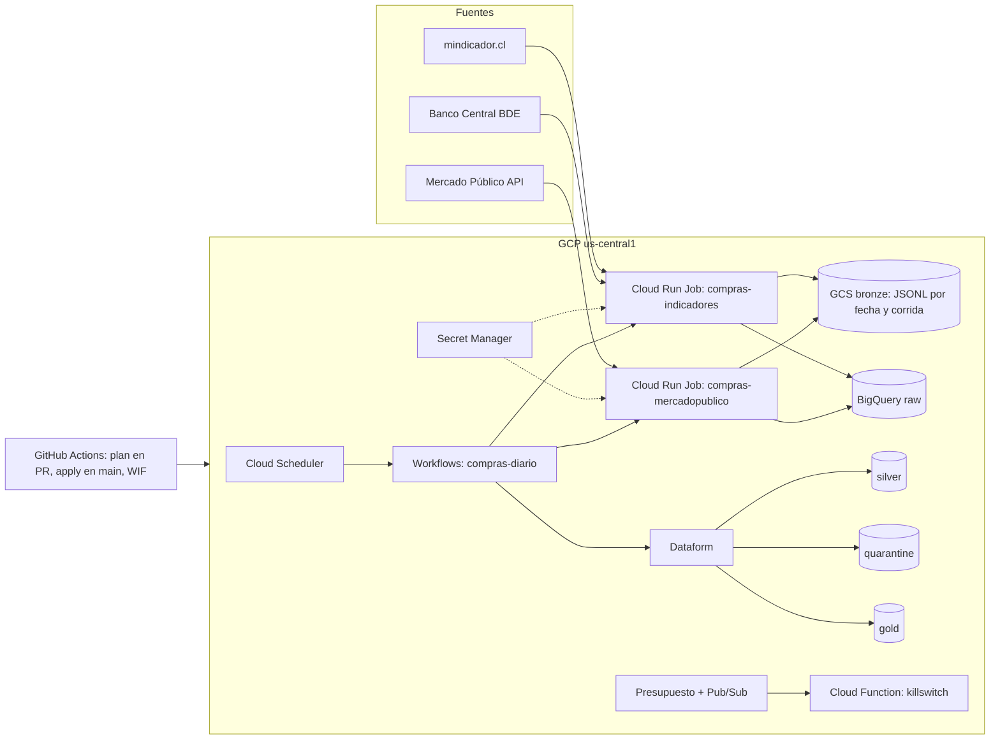

# compras-publicas-cl

Lakehouse medallion en GCP que ingiere a diario las licitaciones y órdenes de compra de Mercado Público, las cruza con
la UF, el dólar y el IPC del Banco Central y lo despliega todo con Terraform y GitHub Actions, con un costo de USD 0 a 1
al mes y un tope duro de USD 10.

## Arquitectura

Bronze guarda las respuestas crudas de cada fuente, por fecha y corrida; raw las carga a BigQuery sin transformar;
silver limpia, tipa y deduplica en Dataform; quarantine recibe las filas rechazadas con su motivo; gold expone hechos,
dimensiones y un mart mensual. Todo se crea con Terraform (`infra/`) y se despliega desde `main` con GitHub Actions
autenticado por Workload Identity Federation, sin llaves de cuenta de servicio.

## Qué demuestra

| Requisito del rol | Pieza del repo |
|---|---|
| BigQuery: particiones, clustering, cargas incrementales | `dataform/definitions/outputs/fct_licitaciones.sqlx`, `dataform/definitions/intermediate/licitaciones.sqlx` |
| Dataform: modelos, assertions, descripciones obligatorias | `dataform/definitions/`, `dataform/includes/reglas.js`, `scripts/ci/check-descriptions.mjs` |
| Cloud Run Jobs con imagen propia y secretos en Secret Manager | `ingest/`, `ingest/Dockerfile`, `infra/modules/ingest_job/` |
| Orquestación sin Composer: Scheduler, Workflows y Dataform | `orchestration/`, `infra/modules/orchestration/` |
| Terraform modular con pruebas offline (`terraform test` con proveedor simulado) | `infra/main/`, `infra/modules/`, `infra/main/tests/main.tftest.hcl` |
| CI/CD: `terraform plan` comentado en el PR, apply en `main`, WIF, environment protegido | `.github/workflows/ci.yml`, `.github/workflows/deploy.yml` |
| FinOps: tope duro, cuotas de BigQuery, benchmark de bytes facturados | `finops/killswitch/`, `infra/modules/quotas/`, `benchmarks/` |
| Calidad como código: assertions, cuarentena con motivo | `dataform/definitions/assertions/`, `dataform/definitions/intermediate/quarantine_licitaciones.sqlx` |
| Gobierno: descripciones en todas las columnas, policy tags sobre el RUT de personas naturales | `infra/modules/governance/`, `scripts/it/policy-tags.sh` |
| Operación: respaldo del estado fuera del proyecto, verificaciones de integración | `scripts/backup-state.sh`, `scripts/it/` |

## Cómo reproducir

Prerrequisitos: un proyecto GCP nuevo con cuenta de facturación, `gcloud` autenticado como dueño (ADC con proyecto de
cuota: `gcloud auth application-default set-quota-project <proyecto>`), un repo en GitHub, un ticket de la API de
Mercado Público, un token de la BDE del Banco Central y un token fine-grained de GitHub con lectura de contenidos para
Dataform. Sin sudo: `scripts/setup.sh` instala en `.tools/` las versiones fijadas de Node, Terraform, uv y Python; todo
comando de herramientas va con `scripts/env.sh` delante.

1. **Bootstrap** (estado remoto, WIF, presupuesto y killswitch): exporta `TF_VAR_project_id`, `TF_VAR_region`,
   `TF_VAR_github_repository`, `TF_VAR_billing_account` y `TF_VAR_alert_email`, y aplica `infra/bootstrap/` a mano con
   `scripts/it/tf-apply.sh bootstrap`. Sus salidas (`state_bucket`, `workload_identity_provider`, `ci_service_account`)
   van como variables del repo de GitHub junto con el environment `production`.
2. **Secretos**: una versión de cada uno con `gcloud secrets versions add <nombre> --data-file=-`:
   `mercadopublico-ticket`, `bcentral-token` y `dataform-github-token`. Terraform crea los secretos vacíos y nunca ve
   los valores.
3. **Apply**: un merge a `main` dispara `.github/workflows/deploy.yml`: `terraform apply` de `infra/main/`, respaldo
   del estado, imagen de ingesta etiquetada con el commit, actualización de los jobs y una corrida de Dataform en el
   esquema `ci`. `scripts/it/tf-plan.sh main` después del apply debe salir sin cambios.
4. **Primera corrida**: `scripts/it/run-workflow.sh` ejecuta el Workflow diario y espera su estado final. Desde ahí
   el Scheduler lo repite cada día.

Las verificaciones de integración de `scripts/it/` (ingesta real de cada fuente, carga a raw, Dataform en `ci`, policy
tags, respaldo del estado) se corren a mano con las credenciales del dueño; el resultado de la primera vuelta está en
`docs/demo/integracion-2026-10-26.md`.

**Restaurar el estado de Terraform** (REQ-016): cada apply deja una copia en el bucket de respaldo de un proyecto
aparte, `infra-main/<marca>-<sha>.tfstate`, y `scripts/backup-state.sh bootstrap` sube la del bootstrap. Para
restaurar, `terraform state push <copia>` en una copia de `infra/main/` con backend local; `scripts/it/state-backup.sh`
ensaya exactamente eso sin tocar el estado real.

**Si el killswitch desvinculó el billing**: en la consola de facturación, volver a vincular la cuenta al proyecto y
subir `budget_usd` en `infra/bootstrap/` si el tope quedó corto. Los recursos no se borran; solo dejan de funcionar
hasta que el billing vuelve.

## Costos y FinOps

- **Tope duro**: presupuesto de USD 10 al mes con avisos al 50 % y 90 %; al 100 % un mensaje de Pub/Sub dispara la
  función de `finops/killswitch/`, que desvincula la cuenta de facturación del proyecto. Vive en `infra/bootstrap/`,
  fuera del alcance de lo que ella misma apaga.
- **Cuotas de BigQuery**: 50 GiB de bytes consultados por día en el proyecto y 20 GiB por usuario (cuentas de servicio
  incluidas), declaradas en `infra/modules/quotas/`. Un error en una consulta no puede gastar más que eso.
- **Presupuesto de requests**: el job de Mercado Público tiene un tope diario de 9.000 requests contra la API, para
  no agotar el ticket.
- **Costo mensual medido**: <!-- costo --> pendiente de leer en la consola de facturación al cierre de octubre de 2026.

## Benchmark

`benchmarks/` genera en BigQuery 40 millones de licitaciones sintéticas en tres variantes (sin partición,
particionada por fecha, particionada y agrupada por organismo y proveedor) y corre las mismas consultas contra las
tres, con dos reescrituras del lado del SQL. Los bytes facturados salen de `INFORMATION_SCHEMA.JOBS`, no de
estimaciones. Corrida real del 2026-10-26 (`benchmarks/results/2026-10-26.md`, caché desactivada):

| Consulta | Sin partición | Particionada por fecha | Particionada y agrupada | Ahorro |
|---|---|---|---|---|
| q1 mart organismo-mes | 1.667 MB | 333 MB | 333 MB | 80 % |
| q2 organismo-trimestre | 2.668 MB | 132 MB | 69 MB | 97,4 % |
| q3 adjudicadas por mes | 1.548 MB | 310 MB | 310 MB | 79,9 % |

| Reescritura | Antes | Después | Ahorro |
|---|---|---|---|
| r1 `SELECT *` → solo las columnas usadas | 187 MB | 60 MB | 68 % |
| r2 self join → ventana | 376 MB | 376 MB | 0 % (misma lectura, 3,6 veces más slot-ms: la reescritura no se recomienda) |

Por qué los dry runs son cota superior: el estimador de BigQuery informa los bytes antes de la poda por clustering, así
que un `--dry_run` sobre una tabla agrupada da bytes mayores o iguales que los facturados de verdad. En la misma
corrida (`benchmarks/results/2026-10-26-estimado.md`), q2 sobre la variante agrupada estimó 132 MB y facturó 69 MB. Por
eso la tabla reporta bytes facturados.

## Calidad

- **Assertions de Dataform** en `dataform/definitions/assertions/`: unicidad de claves, continuidad de la UF y del
  dólar (un hueco de cinco días hábiles falla), conciliación de la UF entre el Banco Central y mindicador.cl, y
  condiciones por fila en los hechos.
- **Cuarentena con motivo**: las reglas de `dataform/includes/reglas.js` (`clave_nula`, `rut_dv_invalido`,
  `monto_negativo`, `moneda_desconocida`, `fecha_fuera_de_rango`) mandan la fila a `quarantine.*` con la lista de
  motivos y la corrida, y silver no la recibe. Las mismas reglas se prueban en JavaScript y en SQL.
- **Incidente real atrapado**: <!-- incidente --> pendiente de la primera corrida diaria completa.

## Gobierno

- Toda tabla y columna de silver, gold y quarantine declara su descripción en Dataform; `npm run check:descriptions`
  falla si falta una y corre en CI.
- El RUT de personas naturales lleva el policy tag `compras_publicas/dato_personal/rut`, declarado en Terraform
  (`infra/modules/governance/`) y aplicado por Dataform al crear la columna. Una cuenta sin el rol de lector
  fine-grained ve la tabla pero no esa columna; `scripts/it/policy-tags.sh` lo comprueba con la cuenta
  `compras-lector`. Las taxonomías viven en Knowledge Catalog (ex Dataplex Universal Catalog); Data Catalog se apagó
  el 1 de junio de 2026 y aquí no se usa.
- Los proveedores se identifican en gold por una clave derivada con sal (`pii.sal`), no por el RUT.

## Nota sobre GitLab CI

El mismo flujo cabe en GitLab CI con `id_tokens` de OIDC contra el mismo proveedor de Workload Identity Federation
(audiencia `https://gitlab.com`), un job de `terraform plan` en merge requests que comente con la API de notas y un
job de `apply` en `main` con `environment: production` y aprobación manual. No requiere llaves de cuenta de servicio
en ninguno de los dos.

## Cómo se construyó

El autor escribió la especificación (`spec/SPEC.md`: 16 requisitos con ejemplos de aceptación, decisiones en
`spec/adr/` y `spec/DECISIONS.md`) y revisó cada entrega; la implementación la hicieron agentes de Claude Code contra
esa especificación, tarea por tarea (`spec/TASKS.json`), con un orquestador que exige plan criticado, pruebas locales
sin nube, evidencia registrada y revisión independiente antes de cerrar. El registro completo, sesión por sesión, está
en `spec/LOG.md`. La demo en vivo (despliegue real, verificaciones de integración y este README) siguió el checklist de
`openspec/changes/demo-en-vivo/tasks.md`.

## Qué se rompió

- **El runner de GitHub cambió de `timeout`.** `ubuntu-latest` pasó a Ubuntu 26 y su `timeout` es uutils, que mata al
  hijo justo después de reenviar la señal; las pruebas del orquestador fallaban solo en CI. Diagnosticado con `strace`
  en el runner; los workflows quedaron fijados a `ubuntu-24.04` y las pruebas del protocolo salieron del CI del
  producto (`.github/workflows/protocol.yml`), que bajó de 20 a 2 minutos.
- **Dos `apply` a medias en el primer despliegue.** El Workflow exige que exista el agente de servicio de Workflows
  antes de crearse, y el output del Scheduler indexaba un bloque `retry_config` que la API omite cuando vale 0. Ambos
  se vieron solo con un apply real; las pruebas con proveedor simulado no los detectan.
- **El Banco Central responde en ISO-8859-1.** `httpx` decodificaba el JSON como UTF-8 y fallaba en la primera tilde
  («Dólar observado»). Se arregló leyendo el charset de la respuesta.
- **mindicador.cl corta el handshake TLS a ratos.** Esa excepción escapaba del cliente HTTP y tumbaba el job; ahora
  todo error de transporte se reintenta y la fuente secundaria queda como ausente con aviso.
- **Scripts de verificación demasiado estrictos.** La comparación del estado restaurado exigía el mismo `serial`
  (`terraform state push` lo sube en uno) y `bq --format=csv` entrecomilla un valor con coma. Y `scripts/env.sh`
  escondía `gcloud` y `bq` del operador.
- **Dos tareas escaladas al usuario durante la construcción** (T-06 y T-18): el orquestador no pudo clasificar la causa
  del fallo con suficiente confianza y paró a preguntar, que es lo que debe hacer.

## Fuentes

- ChileCompra, API de Mercado Público (licitaciones y órdenes de compra): <https://api.mercadopublico.cl>
- Banco Central de Chile, Base de Datos Estadísticos (UF, dólar observado, IPC): <https://si3.bcentral.cl/Siete/>
- mindicador.cl como fuente secundaria de UF y dólar, sin SLA.
